<!-- =========================================================================
     JEEVAN KUMAR - SOFTWARE DEVELOPER
     Theme: Electric Cyan & Deep Indigo
     ========================================================================= -->

<div align="center">

  <!-- HEADER BANNER -->
  <a href="https://github.com/Jeevankumar-coder-tech">
    
  </a>

  <!-- TYPING CADENCE -->
  <a href="https://github.com/Jeevankumar-coder-tech">
    
  </a>

  <br/>

  <!-- STATUS PILLS -->
  <p align="center">
    <a href="https://github.com/Jeevankumar-coder-tech">
      
    </a>
    
    <a href="mailto:jeevanofficial2004@gmail.com">
      
    </a>
    <a href="https://github.com/Jeevankumar-coder-tech?tab=repositories">
      
    </a>
  </p>

</div>

---

## Overview

I build full-stack web applications with a focus on clear logic, clean code, and practical machine learning integrations. My day-to-day work centers around React on the frontend, Python and Node.js for backend services, MySQL for structured data storage, and AWS for hosting and cloud services.

I hold a Bachelor of Technical Education in Information Technology from Veltech Dr. Rangarajan & Sagunthala R&D Institute of Science and Technology. When building software, I prioritize maintainable architectures, fast page loads, and intuitive interfaces over unnecessary complexity.

### Core Focus Areas

- **Frontend Systems:** Building modular, component-driven user interfaces in React with Vite and Tailwind CSS. Responsive layouts, accessible markup, and predictable state management.
- **Backend & APIs:** Designing RESTful services in Python and Node.js with structured request validation, clean error handling, and secure authentication.
- **Databases & Data Modeling:** Structuring relational databases in MySQL with normalized schemas, indexed lookups, and transactional data integrity.
- **AI Integrations & Cloud:** Connecting LLM APIs for automated analysis, document parsing, and dynamic question generation, deployed on AWS cloud infrastructure.

---

## Technical Stack

<div align="center">

  <!-- ANIMATED TECH MARQUEE (Continuous Smooth Horizontal Flow) -->
  <p align="center">
    
  </p>

  <!-- MODERN SQUIRCLE ICON TILES -->
  <p align="center">
    <a href="https://skillicons.dev">
      
    </a>
  </p>

  <br/>

  <!-- STRUCTURED BADGE CATEGORIES -->
  <p align="center">
    <b>Languages:</b>&nbsp;
    
    
    
    
    
  </p>

  <p align="center">
    <b>Frontend &amp; UI:</b>&nbsp;
    
    
    
    
  </p>

  <p align="center">
    <b>Backend &amp; Cloud:</b>&nbsp;
    
    
    
    
  </p>

  <p align="center">
    <b>AI &amp; Tooling:</b>&nbsp;
    
    
    
    
  </p>

</div>

---

## Featured Work

### 1. AI Resume & Interview Assistant
An end-to-end web tool that evaluates resumes against job descriptions, calculates ATS keyword and formatting compatibility scores, and generates tailored interview scenarios with scoring rubrics.

- **Frontend:** Built with React.js and Tailwind CSS for interactive resume scoring dashboards and dynamic feedback cards.
- **AI Backend:** Structured prompt pipelines using Python and LLM endpoints to output consistent JSON schemas.
- **Capabilities:** Instant match percentage, missing skill recommendations, and role-specific technical question generation.

```
Stack: React.js · Python · Generative AI APIs · Tailwind CSS · REST API
```

---

### 2. Full-Stack E-Commerce Platform
A web application designed for fast product catalog browsing, faceted filtering, persistent shopping cart sessions, and a multi-step checkout workflow.

- **Architecture:** Client-side state handling with local synchronization paired with a relational backend.
- **Database:** Normalized MySQL tables for products, inventory counts, user orders, and categories.
- **Capabilities:** Real-time search by price and category, optimistic cart updates, and responsive mobile-first UI.

```
Stack: React.js · JavaScript · MySQL · Node.js · Express
```

---

### 3. Cloud-Native Web Architectures & REST APIs
A collection of modular backend services structured for cloud deployment on AWS infrastructure.

- **Infrastructure:** AWS EC2 instances, S3 storage buckets for static assets, and managed database connections.
- **Security & Data:** Token authentication, rate limiting on sensitive routes, and structured MySQL transactions.
- **Capabilities:** Predictable REST endpoints, environment-based configuration, and automated deployment routines.

```
Stack: AWS (EC2, S3) · Python · MySQL · REST Architecture
```

---

## GitHub Activity & Analytics

<div align="center">

  <!-- Streak Stats Card -->
  <a href="https://github.com/Jeevankumar-coder-tech">
    
  </a>
  <!-- Top Languages Card -->
  <a href="https://github.com/Jeevankumar-coder-tech">
    
  </a>

  <br/><br/>

  <!-- Overall GitHub Stats Card -->
  <a href="https://github.com/Jeevankumar-coder-tech">
    
  </a>

</div>

---

## Contact

I am open to software engineering roles, full-stack development projects, and technical collaborations.

<p align="center">
  <a href="mailto:jeevanofficial2004@gmail.com" target="_blank">
    
  </a>
  <a href="https://github.com/Jeevankumar-coder-tech" target="_blank">
    
  </a>
  <a href="https://linkedin.com" target="_blank">
    
  </a>
</p>

<br/>

<!-- FOOTER WAVE -->
<div align="center">
  
</div>
